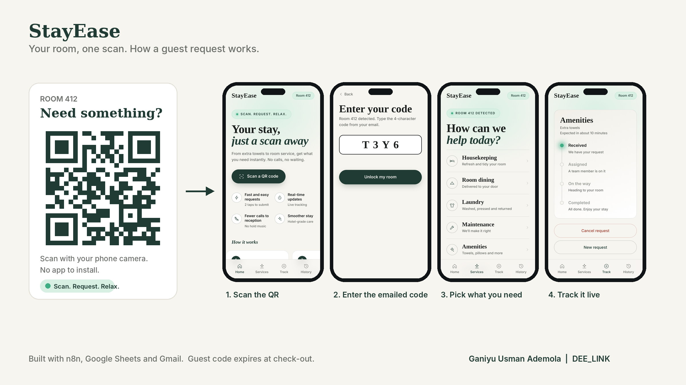
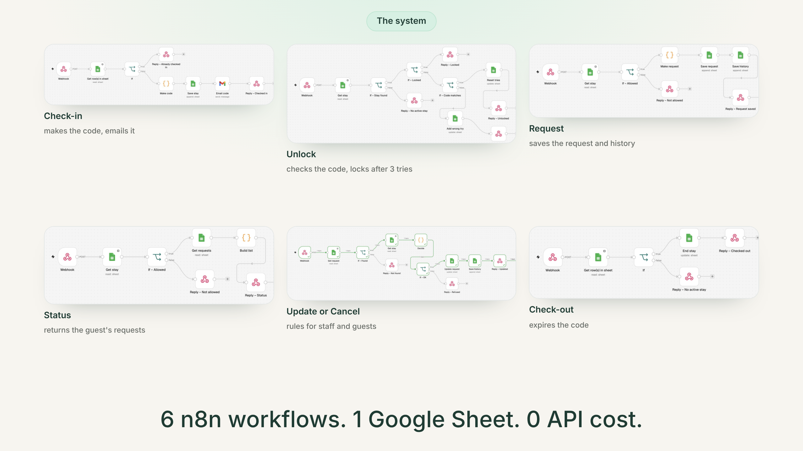

# StayEase — Your room, one scan

A hotel guest-request system that runs on a QR code. No app to install, no calls to reception.

A guest scans the QR code in their room, enters the 4-character code emailed at check-in, and taps what they need. Staff see it on a dashboard and move it along. The guest watches it live: **Received → Assigned → On the way → Completed**.

## What's in this repo

| Path | What it is |
|---|---|
| `index.html` | Guest page (mobile) |
| `staff/index.html` | Staff dashboard (check-in, check-out, requests, cancel) |
| `demo/index.html` | Self-playing demo with the real n8n canvases, sheet and email |
| `screenshots/` | n8n workflows, Google Sheet tabs, guest app screens, LinkedIn images |

## How it works

- **6 n8n workflows:** Check-in, Unlock, Request, Status, Update or Cancel, Check-out
- **Google Sheet as the database:** `Stays`, `Requests`, `History` tabs. Every status change is logged with who, when and why.
- **Gmail** sends the branded check-in code email.

## Rules built in

- Each guest gets a new 4-character code (no look-alike characters). It expires at check-out.
- 3 wrong code tries locks the stay until reception resets it.
- Guests can cancel only before the request is on the way. Staff can cancel any time, with a reason.
- Cancelling never deletes anything; it stays in history.
- If two staff update the same request at once, the second update is refused.

## Status

Portfolio build. The guest page and dashboard in this repo run on demo data; the n8n workflows and Google Sheet are built and tested separately.

**Coming next:** WhatsApp, Viber and SMS code delivery, individual staff logins, and a Postgres upgrade for larger hotels.

## Built by

Ganiyu Usman Ademola — DEE_LINK, AI and workflow automation.
